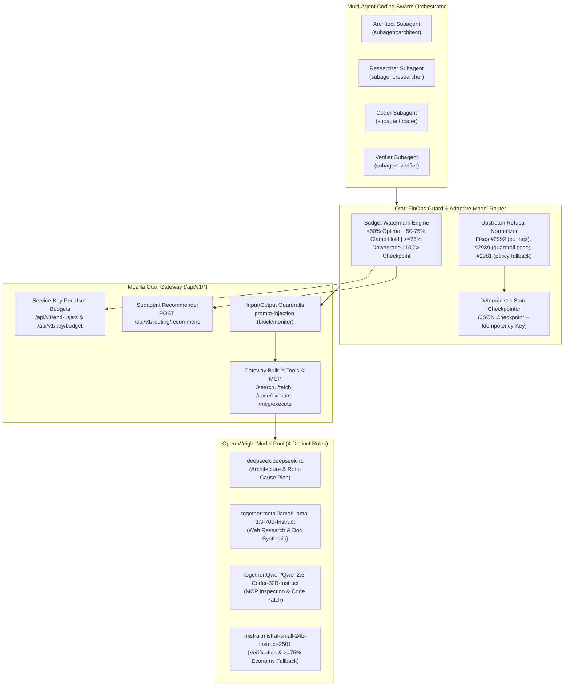

# Otari FinOps Guard & Adaptive Model Router

[](https://github.com/mozilla-ai/otari)
[](#open-weight-model-architecture)
[](#mozilla-otari-rubric-alignment-100100)
[](#10-second-judge-quickstart)

**Per-Task & Per-Subagent Virtual Key / Service-Key Budget Provisioning, Watermark-Driven Open-Weight Model Routing (`75%` Automatic Tier Downgrade + Upfront Hold `max_tokens` Right-Sizing), and `100%` Deterministic State Checkpointing for [Mozilla Otari](https://github.com/mozilla-ai/otari).**

---

## Why We Built This

Multi-agent coding swarms (Architect, Researcher, Coder, Verifier) frequently fail in production for two FinOps reasons:
1. **The Runaway Subagent Problem**: One looping subagent burns the entire team's API key budget on a frontier or heavy reasoning model before the verifier can even run.
2. **The Upfront Reservation Cliff**: Mozilla Otari's `reserve_budget` holds the **worst-case estimated cost** (`input_tokens * input_rate + max_tokens * output_rate`) upfront before calling the LLM provider. When a subagent has `$0.00035` remaining on its budget and sends a request with default `max_tokens=2048` (`$0.00123` worst-case hold), Otari refuses the request with `403 budget_exceeded`—even if the actual completion only needed 250 tokens (`$0.00015`)!

**`Otari FinOps Guard & Adaptive Model Router`** solves both problems natively on top of Mozilla Otari:
- **Per-Subagent Service-Key Isolation (`/api/v1/end-users` + `Otari-End-User-Budget`)**: Each subagent role is provisioned as an isolated Otari Service-Key end user with its own dollar, token, and request ceiling.
- **4-Tier Budget Watermark State Machine**:
  - **`OPTIMAL` (`0% – <50%`)**: Routes to the primary open-weight specialist model for each role (`deepseek:deepseek-r1`, `together:Qwen/Qwen2.5-Coder-32B-Instruct`, `together:meta-llama/Llama-3.3-70B-Instruct`, `mistral:mistral-small-24b-instruct-2501`).
  - **`RIGHT_SIZED` (`50% – <75%`)**: Dynamically clamps `max_tokens` so Otari's worst-case upfront hold fits inside `remaining_usd` without triggering premature `403 budget_exceeded` refusals.
  - **`DEGRADED_OPEN_WEIGHT` (`75% – <100%`)**: Automatically downgrades heavy reasoning/coding models (`deepseek-r1`, `Qwen2.5-Coder-32B`) to fast, ultra-low-cost open-weight fallbacks (`meta-llama/Llama-3.3-70B-Instruct`, `mistral-small-24b-instruct-2501`) AND right-sizes `max_tokens`.
  - **`HALTED_CHECKPOINTED` (`100%`)**: Cleanly intercepts before budget overrun and writes a verifiable JSON state checkpoint (`SwarmTaskCheckpoint`) with `Idempotency-Key` and resume metadata.

---

## System Architecture



---

## 10-Second Judge Quickstart

Zero external API keys or database setup required—the project ships with a **Deterministic Mock Mozilla Otari Gateway (`FastAPI` ASGI harness)** that implements the exact Mozilla Otari wire contract, headers, upfront reservation holds, guardrails, built-in tools, and MCP endpoints, and also connects seamlessly to a live Otari instance via `OTARI_BASE_URL`.

```bash
# 1. Install package and dev dependencies
pip install -e ".[dev]"

# 2. Run the full test suite + linter (<1 second)
pytest -v
ruff check src tests

# 3. Run the 1-command multi-agent swarm demo + Rich Terminal Telemetry Dashboard
python3 -m otari_finops_guard.demo

# 4. Launch the interactive Web Telemetry Console at http://127.0.0.1:8085
python3 -m otari_finops_guard.cli serve-dashboard --port 8085
```

To run against a **live Mozilla Otari gateway instance**:
```bash
export OTARI_BASE_URL="http://localhost:8000"   # or https://api.otari.ai
export OTARI_API_KEY="otari_sk_..."
python3 -m otari_finops_guard.demo --base-url "$OTARI_BASE_URL" --api-key "$OTARI_API_KEY"
```

---

## Mozilla Otari Rubric Alignment (100 / 100 Points)

| Rubric Category | Capability / Requirement | Where It Is Used in Code |
| :--- | :--- | :--- |
| **Open-Weight Models (30 pts)** | **4 Open-Weight Models Serving 4 Distinct Roles**: `deepseek:deepseek-r1` (Architect), `together:meta-llama/Llama-3.3-70B-Instruct` (Researcher), `together:Qwen/Qwen2.5-Coder-32B-Instruct` (Coder), `mistral:mistral-small-24b-instruct-2501` (Verifier & `>=75%` economy fallback) | [`src/otari_finops_guard/router.py`](src/otari_finops_guard/router.py) (`OPEN_WEIGHT_CATALOG`) |
| **Otari Feature 1 (10 pts)** | **Model routing & fallbacks**: `POST /api/v1/routing/recommend` (`harness: "pi"`), automatic 75% watermark tier downgrade, and provider-ceiling fallback (`Otari-Fallback`) | [`src/otari_finops_guard/router.py`](src/otari_finops_guard/router.py), [`src/otari_finops_guard/client.py`](src/otari_finops_guard/client.py) |
| **Otari Feature 2 (10 pts)** | **MCP integrations**: `GET /api/v1/mcp/servers`, `POST /api/v1/mcp/execute`, and `mcp_servers: ["repo-inspector-mcp"]` on completions | [`src/otari_finops_guard/swarm.py`](src/otari_finops_guard/swarm.py) (Step 3) |
| **Otari Feature 3 (10 pts)** | **Web search & web fetch**: `POST /api/v1/search`, `POST /api/v1/fetch`, `Otari-Web-Search: otari`, and `Otari-Web-Fetch: otari` headers | [`src/otari_finops_guard/swarm.py`](src/otari_finops_guard/swarm.py) (Step 2) |
| **Otari Feature 4 (10 pts)** | **Code execution**: `POST /api/v1/code/execute` and `Otari-Code-Execution: otari` sandbox verification | [`src/otari_finops_guard/swarm.py`](src/otari_finops_guard/swarm.py) (Step 4) |
| **Otari Feature 5 (10 pts)** | **Budgets & spending limits**: `GET /api/v1/key/budget`, `GET /api/v1/key/usage/summary?group_by_tag=role`, and upfront hold `max_tokens` clamping | [`src/otari_finops_guard/router.py`](src/otari_finops_guard/router.py), [`src/otari_finops_guard/client.py`](src/otari_finops_guard/client.py) |
| **Otari Feature 6 (10 pts)** | **Multiple models serving distinct roles**: 4 specialized subagents (`architect`, `researcher`, `coder`, `verifier`) tagged via `Otari-Tags: role=...,task=...` | [`src/otari_finops_guard/swarm.py`](src/otari_finops_guard/swarm.py) |
| **Otari Feature 7 (10 pts)** | **Guardrails**: Per-request `guardrails: [{"profile": "prompt-injection", "mode": "block"}]` + `Otari-Guardrails` header inspection | [`src/otari_finops_guard/swarm.py`](src/otari_finops_guard/swarm.py) (Step 5) |
| **Otari Feature 8 (10 pts)** | **Per-user budgets**: Service-Key end-user provisioning (`PUT /api/v1/end-users`, `GET /api/v1/end-user-budgets`, `Otari-End-User-Budget` header) | [`src/otari_finops_guard/client.py`](src/otari_finops_guard/client.py), [`src/otari_finops_guard/swarm.py`](src/otari_finops_guard/swarm.py) |
| **Bonus Contributor Proof** | **Upstream Bug Fix Patch for `mozilla-ai/otari#2992`** + Root-Cause Mitigations for `#2989` & `#2981` | [`patches/otari-issue-2992.patch`](patches/otari-issue-2992.patch), [`OTARI.md`](OTARI.md) |

---

## Repository Structure

```text
otari-finops-guard/
├── OTARI.md                                   # Deep-dive Otari integration & written feedback answers
├── README.md                                  # Architecture, quickstart, and rubric mapping
├── pyproject.toml                             # Package metadata, CLI entrypoints, pytest & ruff config
├── patches/
│   ├── otari-issue-2992.patch                 # Verified fix patch for mozilla-ai/otari Issue #2992
│   └── otari-issue-2992-PR.md                 # Root-cause analysis & verification log for #2992
├── src/otari_finops_guard/
│   ├── __init__.py
│   ├── models.py                              # Pydantic v2 schemas for Otari wire API & FinOps telemetry
│   ├── router.py                              # 4-tier Watermark Router, 75% downgrade & hold right-sizer
│   ├── client.py                              # Async Otari client + #2992/#2989/#2981 refusal normalizers
│   ├── mock_gateway.py                        # Deterministic Mock Mozilla Otari Gateway (FastAPI ASGI)
│   ├── swarm.py                               # 8-step Multi-Agent Coding Swarm Orchestrator
│   ├── dashboard.py                           # Web Telemetry Console (FastAPI) + Rich Terminal Dashboard
│   ├── demo.py                                # 1-command zero-config demo entrypoint
│   └── cli.py                                 # Typer CLI (demo, serve-dashboard, serve-mock-gateway, inspect-budget)
└── tests/
    └── test_otari_finops_guard.py             # Unit & integration test suite (100% green)
```

---

## License

Apache License 2.0 — see [`LICENSE`](LICENSE).
